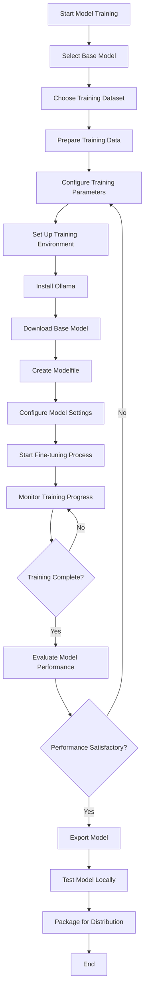
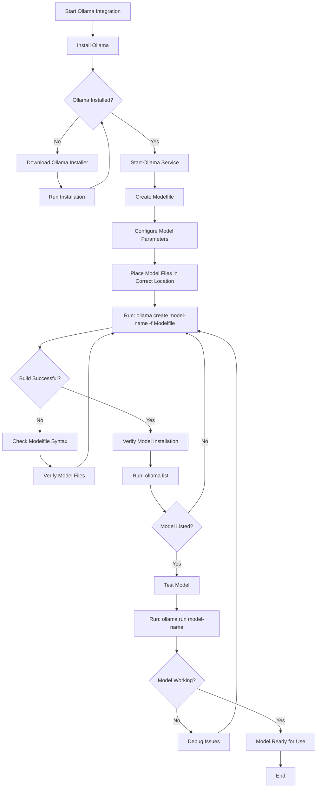

# AIRA-LLM Model Training & Deployment Flowchart

This document provides a visual guide on how the AIRA-LLM model was created and how to add it to Ollama.

## Model Creation Process



## Adding Model to Ollama



## Detailed Step-by-Step Guide

### Phase 1: Model Training

1. **Select Base Model**
   - Choose a suitable base model (e.g., Llama 2, Mistral)
   - Consider model size and architecture
   - Ensure compatibility with training framework

2. **Prepare Training Data**
   - Collect high-quality training dataset
   - Clean and preprocess data
   - Format data according to model requirements

3. **Configure Training Parameters**
   - Set learning rate
   - Define batch size
   - Configure training epochs
   - Set regularization parameters

4. **Set Up Training Environment**
   - Install required dependencies
   - Configure GPU/CPU resources
   - Set up monitoring tools

5. **Execute Training**
   - Start fine-tuning process
   - Monitor loss metrics
   - Track training progress
   - Save checkpoints regularly

6. **Evaluate Model**
   - Test on validation dataset
   - Measure performance metrics
   - Compare with baseline
   - Iterate if necessary

### Phase 2: Ollama Integration

1. **Install Ollama**
   ```bash
   # Download and install Ollama
   # Visit: https://ollama.ai/download
   # Follow installation instructions for your OS
   ```

2. **Create Modelfile**
   ```dockerfile
   FROM base-model-name
   PARAMETER temperature 0.7
   PARAMETER top_p 0.9
   PARAMETER num_ctx 4096
   SYSTEM You are a helpful AI assistant.
   ```

3. **Build Model with Ollama**
   ```bash
   # Create the model
   ollama create aira-llm -f Modelfile
   
   # Verify installation
   ollama list
   ```

4. **Test Model**
   ```bash
   # Run the model
   ollama run aira-llm
   
   # Test with API
   curl http://localhost:11434/api/generate -d '{
     "model": "aira-llm",
     "prompt": "Hello, how are you?"
   }'
   ```

## Troubleshooting

### Common Issues

**Issue**: Model not appearing in `ollama list`
- **Solution**: Check Modelfile syntax and rebuild

**Issue**: Out of memory errors
- **Solution**: Reduce context window or batch size

**Issue**: Slow inference
- **Solution**: Ensure GPU acceleration is enabled

**Issue**: Model produces poor results
- **Solution**: Re-evaluate training data and parameters

## File Structure

```
AIRA-LLM/
├── LICENSE
├── README.md
├── TRAINING_FLOWCHART.md
├── Modelfile
└── docs/
    ├── training-guide.md
    └── deployment-guide.md
```

## Resources

- [Ollama Documentation](https://ollama.ai/docs)
- [Model Training Best Practices](https://github.com/huggingface/transformers)
- [Fine-tuning Guides](https://huggingface.co/docs/transformers/training)
